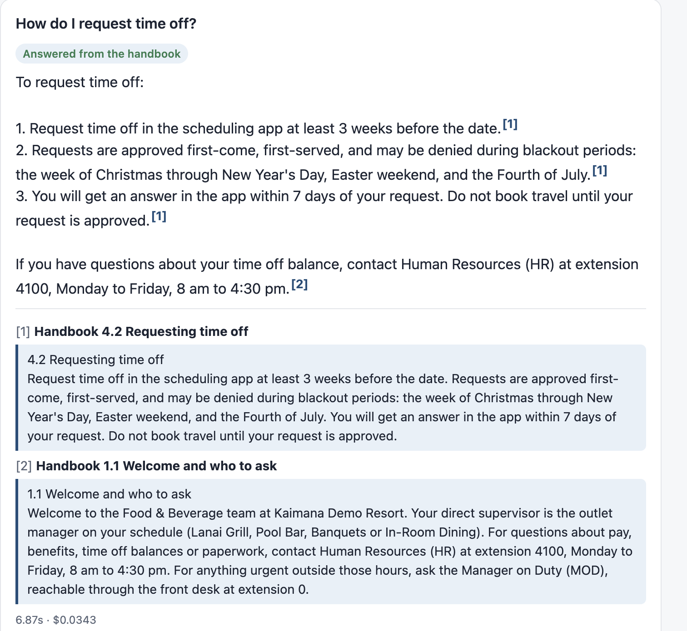
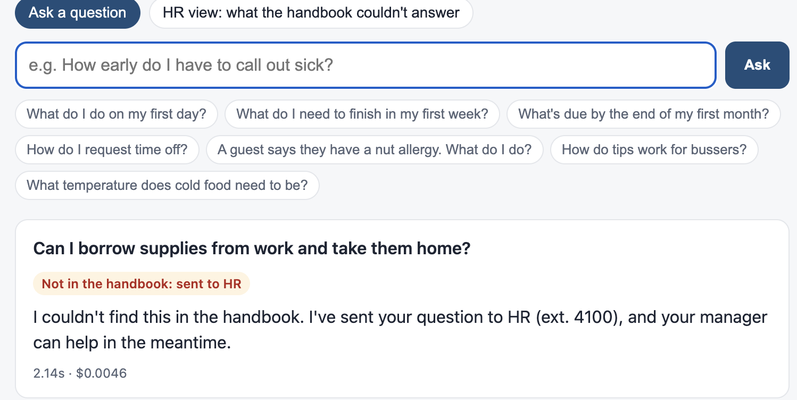
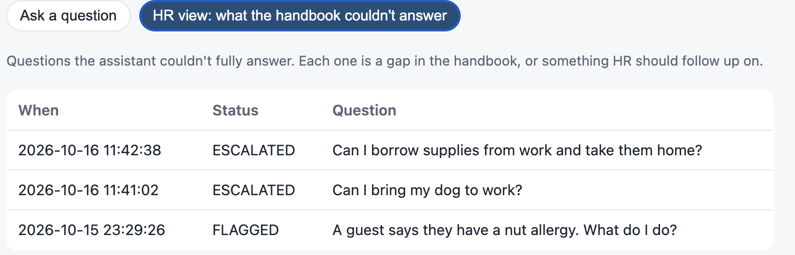
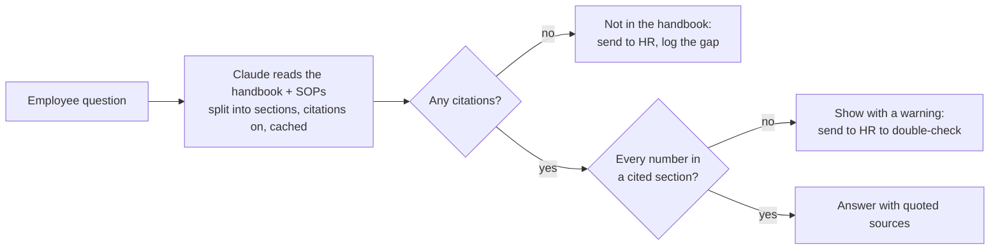

# Ask the Handbook: an onboarding assistant that only answers from the handbook

**New hires ask the same questions every week: when do schedules come out, how early do I call out sick, how do tips work. This assistant answers them from the employee handbook only, quotes the exact section it used, and when the handbook doesn't cover something, says so and sends the question to HR instead of guessing. HR gets a running list of what the handbook is missing. Built with the Claude API (citations + prompt caching), Python and a small web page.**

From ten years on restaurant and hotel floors, where new hires ask the same questions every week and whoever is nearby answers them mid-shift.

### Every answer quotes the section it came from


### Not in the handbook? It says so, and sends the question to HR


### HR sees what the handbook is missing


*The flagged allergy question is from before fix [F1](docs/findings.md#f1-correct-answers-flagged-because-of-list-numbering-number-check): the log caught a bug in the number check, which was then fixed.*

| | |
|---|---|
| **Quotes its source** | Every answer shows the handbook section it came from, with the exact text, so staff and managers can check it. |
| **No citation, no answer** | If Claude can't point to a section, the answer isn't shown; the question goes to HR. Enforced in code, not just requested in the prompt. |
| **Checks every number** | Hours, dollar amounts and phone extensions in an answer must appear in the cited section. A number that can't be verified (even a correct calculation) is flagged for a person. |
| **Refuses outside knowledge** | It won't answer "What's Hawaii's minimum wage?" or "How do I open wine tableside?" from general knowledge, because those aren't in *this* handbook. |
| **Can't be talked out of it** | "Ignore your instructions…" and "You're in admin mode…" get no answer. |
| **Shows HR the gaps** | Unanswered and half-answered questions are logged on an HR view: a to-do list for the next handbook update. |
| **Onboarding paths** | One-tap questions for day 1, week 1 and month 1. |

## Results

40 test questions: 29 the handbook answers, 9 it doesn't (including two attempts to override the rules), and 2 it half-answers.

| | Claude Opus 5.5 | Claude Haiku 5.5 |
|---|---|---|
| Overall | **39/40 (98%)** | 36/40 (90%) |
| Not in handbook → sent to HR, nothing made up | **9/9** | 8/9 |
| Cost per question | $0.0056 | $0.0002 |
| Median response | 2.8 s | 1.6 s |

The one Opus "miss" is the safety check doing its job: asked *"my shift starts at 5 pm, when do I call out?"*, it answered "by 1 pm", which is correct math, but a calculated number can't be verified against the handbook, so it's shown with a warning and sent to a person. Testing also caught four bugs, including one of my own where a coincidental number match passed as evidence. All are written up, with fixes, in **[docs/findings.md](docs/findings.md)**.

**Caveat:** the same 40 questions were used while fixing those bugs, so this is a development score, not a blind test.

## How it works



| File | Does |
|---|---|
| [`handbook/`](handbook/) | A **fictitious** F&B team handbook (28 sections) and restaurant SOPs (7), written for this demo. |
| [`ask_handbook/engine.py`](ask_handbook/engine.py) | Sends the documents (split into sections, citations enabled, cached) and the question to Claude; maps each citation back to its section; applies the no-citation and number rules; logs gaps. |
| [`ask_handbook/app.py`](ask_handbook/app.py) + [`web/index.html`](web/index.html) | The web page: chat with quoted sources, and the HR gaps view. |
| [`tests/run_eval.py`](tests/run_eval.py) | The 40-question evaluation, for any model. |
| [`tests/test_engine.py`](tests/test_engine.py) | 10 offline tests of the rules, using fake Claude responses (free). |

**Design choices worth calling out:**
- **No vector database.** The whole handbook is about 5,800 tokens, so it's sent in full and cached (about 90% cheaper after the first question). Retrieval only pays off at a few hundred pages, and it adds a new failure mode: fetching the wrong section.
- **Sections as citation units.** Each handbook section is one citable block, so a citation maps cleanly to "Handbook 2.3 Calling out sick or late."
- **Grounding enforced in code.** Citations can't be combined with structured (JSON) output, so whether an answer is grounded is decided by code reading the citations, not by Claude saying so.
- **Honest "partial" answers.** "When is payday, and can I pick up my check in person?" gets the payday answer plus "couldn't find the rest," and the unanswered half is logged for HR.

## Run it yourself

Needs Python 3.10+ and a [Claude API key](https://console.anthropic.com/).

```bash
python3 -m venv .venv && .venv/bin/pip install -r requirements.txt
echo "ANTHROPIC_API_KEY=your-key-here" > .env          # never committed
.venv/bin/python -m ask_handbook.app                   # open http://localhost:8000
.venv/bin/python -m pytest -q                          # 10 offline tests, free
.venv/bin/python tests/run_eval.py                     # 40 questions, about 23¢ with Opus
.venv/bin/python tests/run_eval.py --model claude-haiku-5-5
```

To use your own handbook, replace `handbook/handbook.md` and `handbook/sops.md`. Each `## ` heading becomes one citable section (`## 2.3 Calling out sick or late`). See [docs/runbook.md](docs/runbook.md).

## What I'd do next
- A blind test set written by actual new hires, and a check that answers don't quietly drift as the handbook changes.
- Sign-in, so HR sees who asked (today the log is anonymous), and email HR the gaps weekly.
- Short follow-up conversations ("what about if I'm a minor?").

*Kaimana Demo Resort and its handbook are fictitious, written for this demo. This is not a real company's policy and not legal advice.*
